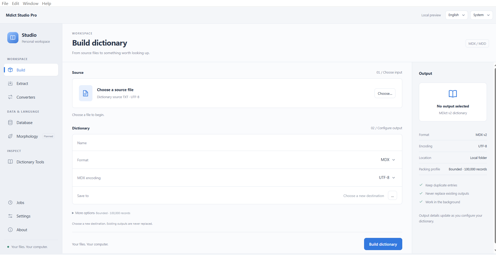

# Mdict Studio Pro — experimental desktop preview

A Rust/Tauri refactor of [MdictStudioPro](https://github.com/shawkynasr/MdictStudioPro), with new features and improvements and English, Chinese and Arabic UI options. The Rust refactor repository is [MdictStudioPro-Rust](https://github.com/shawkynasr/MdictStudioPro-Rust).

GitHub Actions preparation now targets **Windows x64, macOS Intel, macOS Apple Silicon and Linux x64**. The new workflow builds installers from a fresh checkout and creates a **draft prerelease** for preview tags after all four builds pass. The first hosted matrix run succeeded for all four targets, as shown in the user-provided run screenshots. Installation and launch of these new installers remain untested. Earlier local runtime evidence covers Intel macOS only; community testing will establish results for the new artifacts.

Read the [new repository setup guide](docs/GITHUB-PREVIEWS.md), [draft release notes](docs/releases/v0.1.0-preview.1.md), [tester guide](docs/PRERELEASE-TESTING.md) and [publishing checklist](docs/releases/PUBLISHING-CHECKLIST.md). Windows Python plugins and some Unix-only resource operations are currently unsupported. Full original-app parity, full M3 and stable-release readiness remain open.

M2 is complete for its tested native backend foundation, and bounded M4 Database closeout is accepted. Scoped standalone Mac checks cover all six built-in converter fixtures, optional trusted Python conversion, folder inventory/error display, focused Settings keyboard/draft behavior, normal Quit, active idle-Python force-quit cleanup/reopen, missing-input handling, permission-denied retry and same-Mac app relocation. Each remains limited to its recorded profiles and evidence; see the [current release checklist](docs/M3-FIRST-RELEASE-CHECKLIST.md).

Optional plugins require an external Python interpreter and dependencies. They execute with the user's permissions after explicit trust. General crash recovery, older abandoned-stage cleanup, broader compatibility and morphology remain open/deferred. Historical reports retain their original status; later acceptance is recorded separately. M0's full GUI runtime capture remains partial.

The sidebar About dialog includes author credit, app version and official repository/release links. Updates are currently installed manually; see [About and update delivery](docs/ABOUT-AND-UPDATES.md). This addition needs a new CI build and GUI check.

For the next preview’s readability fixes, clearer rebuild destinations and explicit 256 MiB export/TXT-build options, see the [community-feedback update](docs/PREVIEW-2-FEEDBACK.md). Native validation is pending.

## 界面预览 / Screenshots

首次使用请看 [中文图文入门指南](docs/QUICK-START.zh-CN.md)。内置转换器无需安装 Python。

Chinese interface / 中文界面：

English interface / 英文界面：

These are actual first-preview Windows screenshots supplied in user feedback, before the readability update. The next preview increases text size and contrast and adds a saved interface text-size setting. The screenshots show navigation and workflow, not the updated typography.

## License and author

Copyright (c) 2026 **Shawky Nasr** <shawkynasr@126.com> for new project-authored code, except where another notice applies. The new Rust/Tauri implementation is licensed under **AGPL-3.0-only**; see [LICENSE](LICENSE) and [third-party notices](THIRD_PARTY_NOTICES.md). Historical baseline and reference files retain their own terms, including the documented original README/LICENSE discrepancy.

## Current documentation

- [M3 completion review and remaining work](docs/M3-COMPLETION-REVIEW.md)
- [Selected-file plugin discovery and option forms](docs/M3-PLUGIN-DISCOVERY.md)

- [Build the local Mac preview](docs/M3-MAC-PREVIEW.md)

- [Desktop feature audit and packaging path](docs/M3-DESKTOP-AUDIT.md)

- [Database closeout: scope, limits and final regression](docs/M4-DATABASE-CLOSEOUT.md)
- [Database checkpoint ledger](docs/M4-CLOSEOUT-CHECKPOINTS.md)

- [M2 closeout and support matrix](docs/M2-CLOSEOUT.md)
- [Current milestone ledger](docs/M2-REMAINING.md)
- [Machine-readable status](docs/STATUS.json)
- [Closeout evidence decision](docs/evidence/m2-closeout-review/decision.json)
- [M1 engine closeout](docs/M1-CLOSEOUT.md) and [engine decision](docs/ENGINE-DECISION.md)

For the historical M2 closeout, no routine Mac/Rust/native-reader rerun is required. Its closeout uses the recent
accepted native interaction tests, unchanged earlier sources and local
baseline/evidence/contract verification. It does not claim a new native run.

## Qualified backend highlights

- Explicit bounded v2 MDX/MDD import, duplicate-aware indexed lookup, paged
  sessions, source-bound caches and bounded one-shot redirects.
- Supported XML metadata/stylesheet rebuild and publication, with scoped
  independent-reader confirmations.
- All six full native converters: CC-CEDICT, Mini, Idioms, Concise, Revised and WFG.
- Selected complete real dictionary reads, safe MDD extraction, real packing
  and admitted index builds.
- Full 202,884-entry original CC-CEDICT packing in UTF-8 and UTF-16 through the
  explicit block-spooled profile; 57.23 MiB reported controller peak RSS.
- Bounded queues, progress/errors/cancellation, one-transfer results, reader
  cleanup barriers, no-clobber publication and shared operation reservations.

The historical M2 native regression reports contain 39 runtime tests and five
block-writer library tests. Prior accepted gates remain source-bound and their
counts are not added as if every test were unique. The full-converter gate peaked
at 256.29 MiB, the bounded real-publication gate at 169.19 MiB and the full CC pack
at 57.23 MiB. Those are separate process/gate observations, not an OS-enforced
application memory ceiling. See the closeout matrix for exact profiles and caps.

## Preserve the existing local workspace

Merge updates into the existing `mdict-studio-m0-m1` directory. Keep `.venv`,
`vendor`, `real-corpus-inputs`, converter source ZIPs and previous outputs. Private
corpora, workbooks and generated definitions are excluded from distributable
packages. Do not delete your local inputs to replace this package.

There are multiple isolated qualification workspaces. A root `cargo test
--workspace` is not an aggregate M2 test command. The broadest qualified facade
is `m2/cc-pack-runtime`; earlier workspaces and snapshots preserve the history.
Use the gate-specific documentation only when reproducing a changed path or
investigating a failure, rather than routinely rerunning accepted batches.

Local maintenance verification/package creation is `python3 scripts/package.py`.
It runs baseline/evidence/snapshot/Python contract checks; it does not run Rust.

## Tauri shell slice (M3, scoped Mac verification)

The additive Tauri/Svelte shell and native job adapter are in `m3/`. The user has confirmed native compilation and launch, and later Database gates cover the current frontend templates, Rust tests and shell checks. The visual direction is documented in [UI alignment](docs/M3-UI-ALIGNMENT.md). See [the M3 shell instructions](docs/M3-SHELL.md) for setup and the Database closeout instructions above for the final regression. Rust/Svelte execution is performed on the user Mac, not in the authoring environment. M2 qualification is unchanged; full M3 completion remains open.

## Next application work

The final Database regression is prepared in [M4-DATABASE-CLOSEOUT.md](docs/M4-DATABASE-CLOSEOUT.md). Combined editing/MDX reader checks and synthetic/real-dictionary sizing have passed within the documented profiles. The final Mac report is still required before scoped Database completion is recorded.

The additive shell already includes Chinese/English/Arabic localization, static previews and an optional Python plugin bridge. Full original GUI parity and M3 completion remain open. Larger profiles, additional rebuild lookup policies, crash recovery, hard memory protection, Windows/Linux qualification, packaging/signing/updating and production readiness are separate follow-ups. MDX v3 remains deferred.

## Historical instructions

The previous long README is preserved in
[README history](docs/history/README-before-closeout-2026-11-07.md).
Its pending/next statements describe earlier stages and are superseded by the
current closeout. Per-slice documents retain exact reproduction instructions and
limitations; the closeout matrix defines current supported scope.

### Current compatibility follow-up

Simplified one-file plugin GUI workflow is accepted within its tested scope. MDX v2 keyword-index encryption (`Encrypted=2`) export/SQLite support is implemented with independent wire checks; native Mac qualification is pending. See [MDX key-index compatibility](docs/M3-MDX-KEYINFO.md). The sample has 1,829 records; use JSONL or SQLite to preserve its CR-containing definitions. The earlier standalone preview must be rebuilt to include these updates.

### Legacy ASCII compatibility follow-up

The v2 Encrypted=2 JSONL/SQLite app workflow is now accepted. A narrow v1.2 ISO8859-1-labelled ASCII export path is implemented with independent checks for the 310-record Legal Latin sample; Mac native and GUI qualification is pending. See [v1.2 ASCII compatibility](docs/M3-MDX-V1-ASCII.md). Non-ASCII legacy encodings remain unsupported.

### Standalone preview refresh handoff

The v1.2 ASCII development-app JSONL/SQLite checkpoint is accepted (310 records). The next step rebuilds the standalone Mac preview with the latest plugin and compatibility features. Run `.venv/bin/python scripts/m3_mac_preview.py --output m3-shell-out-mac-preview-v3` on the Mac after quitting the apps/dev server. See [Mac preview instructions](docs/M3-MAC-PREVIEW.md). The new .app build and Finder smoke check are pending; no application code or dependencies changed for this refresh.

### Current interface follow-up

Standalone preview v3 is accepted for Finder launch, the 310-record styled Database view, simplified plugin screen and user-confirmed settings restart. The next focused update corrects stale Settings/export wording in English, Chinese and Arabic. See [interface wording pass](docs/M3-UI-COPY.md) and build preview v4 with the existing Mac gate. Native behavior and dependencies are unchanged; Mac compilation and visual review of the new wording are pending.

### Settings interaction fix

Settings now uses a compact modal dialog over the current workspace, preserving form values and closing with Done or Esc. The v4 build passed, but its inline Settings layout was reported as a GUI defect. See [Settings dialog](docs/M3-SETTINGS-DIALOG.md) for the preview-v5 build and focused Mac keyboard/visual check. Native behavior, dependencies and limits are unchanged.

### Current readiness checklist

The compact Settings dialog has a passing v5 Mac build and scoped visual/Esc/Tab acceptance. The current next check is running the options fixture from the standalone app, whose Python screen was previously unconfigured. Use the existing v5 app; no rebuild is needed. See [first-release readiness checklist](docs/M3-FIRST-RELEASE-CHECKLIST.md) for exact fixture inputs and the remaining public-release boundaries.

### Standalone plugin check accepted

The packaged OptionsPlugin conversion is accepted: six records, 203 output bytes and exact input/plugin/options/output hashes. The current next check is the exposed Advanced folder-discovery selector and per-file error display using the existing v5 app. See the current standalone instructions in [plugin folders](docs/M3-PLUGIN-FOLDER.md). No new application build is needed.
