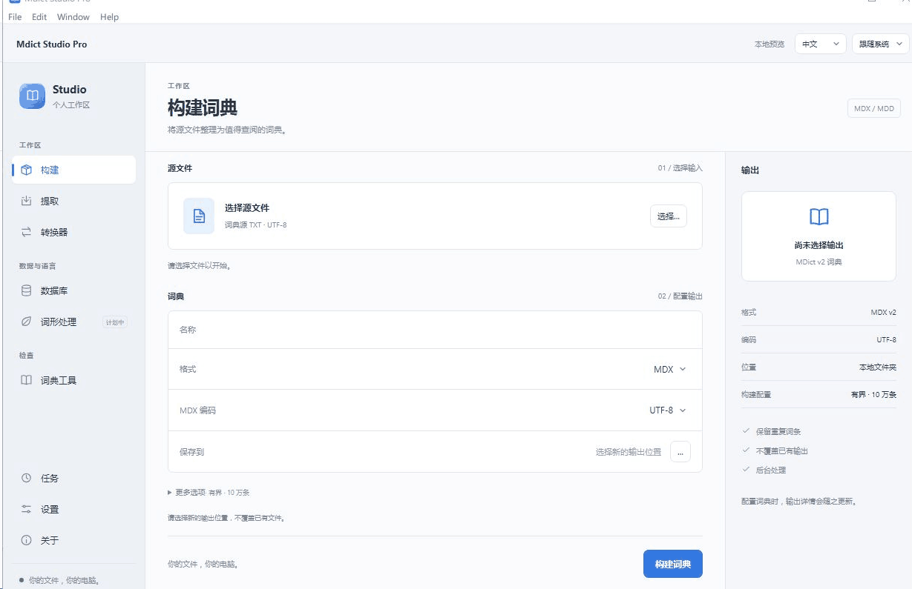

# Mdict Studio Pro Rust：中文图文入门

这是 Rust / Tauri 预览版，欢迎反馈问题。内置转换器不需要 Python；只有可选的 Python 插件需要另行配置解释器。

本页说明当前主分支的操作。界面文字大小设置及 256 MiB 扩展导出属于下一预览版改进；旧的 preview.1 安装包不会自动获得这些功能。

## 界面在哪里？



这是首个 Windows 预览版的真实界面截图，来自用户反馈，展示文字大小与对比度调整前的界面。

左侧「构建」生成 MDX/MDD，「提取」导出词条或资源，「转换器」处理支持的数据源，「词典工具」查询及预览词典，「任务」查看进度和结果。

## 从这里开始：选择你想做的事

| 想做什么 | 左侧入口 | 输入 | 输出 |
|---|---|---|---|
| MDX 拆包为文本 | 提取 | `.mdx` 文件 | 新的 `.txt` 或 `.jsonl` 文件 |
| 文本打包成词典 | 构建 | 词典源 `.txt` 或 `.jsonl` | 新的 `.mdx` 文件 |
| 提取图片、样式和其他资源 | 提取 | `.mdd` 文件 | 尚不存在的新文件夹 |
| 查看词条及 HTML 预览 | 词典工具 | MDX 和新索引路径 | 查询结果和释义预览 |

## 1. MDX → 文本

1. 点击左侧「提取」，选择 MDX 文件。
2. 选择 TXT 或 JSONL。TXT 便于编辑；JSONL 能保留 TXT 无法表示的正文换行及分隔符。
3. 指定尚不存在的输出文件，例如 `词典-export.txt`。
4. 选择导出配置，然后点击「导出条目」。完成后在「任务」中查看结果。

配置按**解压后的词头和释义**计算，不按压缩 MDX 的大小计算。下一预览版的「扩展」配置允许最多 25 万条、256 MiB 解码文本、512 MiB 输出文件；单条释义仍限 1 MiB。使用较大或扩展配置前，请关闭「词典工具」中已打开的词典。

## 2. 文本 → MDX

1. 点击「构建」，选择刚导出的 TXT 文件。
2. 填写词典名称，选择 MDX 和所需的 UTF-8 / UTF-16 编码。
3. 点击「保存到」旁的按钮，使用新文件名，例如 `词典-rebuilt.mdx`。
4. 点击「构建词典」，到「任务」中查看进度。

不要把原 MDX 文件或已有文件夹选作输出。若显示 `destination_exists`，表示输出位置已存在；请返回并换一个文件名，无需删除原文件。

TXT 结构如下（UTF-8，每条最后用独立的 `</>` 行分隔）：

```text
apple
<div>A fruit.</div>
</>
字
<p>一个汉字。</p>
</>
```

导出条目文件不含词典头元数据；数字样式表、标题、说明及 MDD 外部资源需要单独处理。不要将条目导出再构建视为完整词典的自动无损复制。

**导出、构建和 SQLite 的限制彼此独立。** 256 MiB 扩展配置只用于导出，不扩大构建或数据库限制。即使一个大词典可以导出，也不代表它能用当前构建配置重新打包。

## 3. 文字太小或太淡？

下一预览版将增大默认文字、加深说明文字，并使用系统无衬线字体。在「设置」→「界面文字大小」中可选择「标准」「大」「更大」，退出并重开后保留设置。这调整应用界面，不改写词典 HTML 或字体文件。

## 出错时怎么反馈？

请提供系统版本、CPU 架构、预览版号、所做操作以及「错误详情」。发送截图即可帮助定位界面问题；分享日志前请移除私人路径或词典正文。

程序保留已有输出，建议用输入副本及新输出路径测试。
